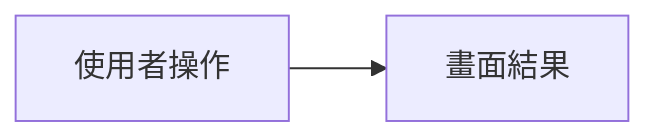

# 前端開發流程

只處理王奕淳在 MS04 的前端工作，順序固定為 D01、D03、D06、D07。一次只做下一個未勾選項目。

## 路徑

文件只讀寫 `SmartMeal_Doc/`。不要讀寫 `teamDoc/SmartMeal_Doc/`。

| 用途 | 路徑 |
|---|---|
| 任務說明 | `SmartMeal_Doc/docs/00-專案/任務/MS04-任務說明.md` |
| 任務狀態 | `SmartMeal_Doc/docs/00-專案/任務/任務認領.md` |
| 規格預覽 | `.cursor/onlyForMeDoc/SmartMeal-spec_預覽_1022.pdf` |
| 畫面實作 | 工作區根目錄的 Vue 專案，`src/` |
| DevToDoList | `.cursor/onlyForMeDoc/DevToDoList.md` |
| API spec | `.cursor/submitToBackend/<任務代號>-api-spec.md` |

不要修改 `SmartMeal_Doc` 內的 Laravel 或 AI API 程式。不要把清單或 spec 寫回這個 `SKILL.md`。

## 步驟

### 1. 產生 DevToDoList

`.cursor/onlyForMeDoc/DevToDoList.md` 已存在就跳過，直接做步驟 2。

還沒有時，先讀規格預覽 PDF、`MS04-任務說明.md`，以及下表該任務的「先讀」。依 D01、D03、D06、D07 各寫一個 TODO，沿用下方範本。每個 TODO 都要連結到 `MS04-任務說明.md`；`任務認領.md` 已有 Issue 時，一併放上 Issue 連結。

| 任務 | 王奕淳要做的範圍 | 先讀 |
|---|---|---|
| D01 | 依架構第 3 節，在這台電腦啟動工作區前端並記錄結果。不實作 Laravel 與 AI API | `SmartMeal_Doc/docs/02-設計/架構.md` |
| D03 | 路由、版面、可在樣本回應與後端之間切換的呼叫層、四類例外與 AI 標示的共用元件 | `SmartMeal_Doc/docs/02-設計/架構.md`、`SmartMeal_Doc/docs/02-設計/訊息與標示.md`、`SmartMeal_Doc/data/樣本回應/`、`SmartMeal_Doc/docs/01-需求/畫面草圖/` |
| D06 | 登入到食用紀錄的第一條流程畫面，先接樣本回應 | `SmartMeal_Doc/docs/01-需求/使用流程.md`、`SmartMeal_Doc/docs/02-設計/訊息與標示.md`、`SmartMeal_Doc/data/樣本回應/`、`SmartMeal_Doc/docs/01-需求/畫面草圖/` |
| D07 | 把已完成畫面接到真正的後端。只改前端接線 | `SmartMeal_Doc/docs/02-設計/介面契約/前端與後端.md`、`SmartMeal_Doc/docs/01-需求/使用流程.md` |

### 2. 實作下一個未勾選項目

只改 `src/`。做完後停下來，請使用者在 DevToDoList 勾選。使用者勾選或明確說完成之前，不要寫 API spec、不要改 `任務認領.md`、不要開分支。

### 3. 確認後收尾

使用者確認該項完成後，依序做這三件事：

1. 依下方範本寫出 `.cursor/submitToBackend/<任務代號>-api-spec.md`。這一項沒有呼叫 API 時，在檔案開頭註明「此項無 API」，並只保留任務代號與畫面行為。
2. `任務認領.md` 已有該任務列時，只把該列狀態改為「完成」，保留原任務代號與 Issue 連結。沒有該列時不要新增，也不要改 `MS04-任務說明.md`；改在 API spec 開頭註明任務代號，並告訴使用者文件裡還沒有可更新的列。
3. 在工作區根目錄建立分支 `alice/spec-<任務代號>`，例如 `alice/spec-D03`。不要 commit、不要 push。工作區有未提交變更時，先告訴使用者，不要強制切換分支。

## DevToDoList 範本

```markdown
## [ ] D03 前端骨架

- 任務說明：[MS04 D03](../../SmartMeal_Doc/docs/00-專案/任務/MS04-任務說明.md)
- Issue：（有才寫）
- 需求說明：
- 完成定義：


```

## API spec 範本

```markdown
# D03 API spec

- 任務代號：D03
- 對應文件：[MS04 任務說明](../../SmartMeal_Doc/docs/00-專案/任務/MS04-任務說明.md)
- 畫面行為：

## API-09 取得建議

- 方法與路徑：
- 請求：
- 回應：
- 樣本回應：`SmartMeal_Doc/data/樣本回應/` 內的檔名
- 畫面如何使用這個回應：
```
